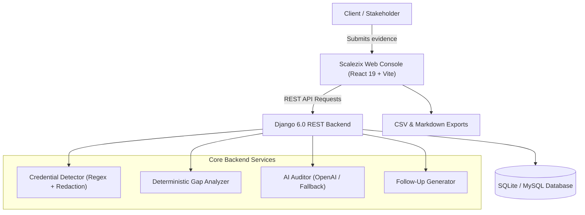

# Scalezix — Client Onboarding Document Checker & Technical Intake Auditor

> **Project 3: Client Onboarding Document Checker**  
> Modern, secure technical document intake, gap analysis, credential sanitization, and automated client follow-up system designed for Scalezix technology consulting engagements.

---

## 1. Executive Summary & Business Context

In software consulting and agency engineering, technical kickoffs are frequently stalled by missing credentials, incomplete architecture diagrams, vague API documentation, and unencrypted secrets leaked into chat or notes.

The **Scalezix Client Onboarding Document Checker** transforms chaotic client intake into an orderly, audited, and secure process:
1. **Standardized Blueprints**: Intake matrices pre-configured for Web Application MVPs, Autonomous AI Agents / LLM Pipelines, and Cloud Infrastructure migrations.
2. **Deterministic Gap Analysis**: Instant rule-based verification flagging missing requirements, incomplete evidence, and readiness percentages with zero hallucination.
3. **Zero-Exposure Credential Security**: Conservative scanning for AWS IAM keys, Stripe secret keys, GitHub tokens, OpenAI keys, RSA/SSH private keys, and plain passwords, automatically masking secrets with `[REDACTED_...]` and enforcing encrypted vault workflows (1Password / Bitwarden).
4. **Automated Polite Follow-Up Composer**: Generates professional, structured client emails grouping missing items, technical questions, and security notices into clear action lists.
5. **Multi-Format Exports**: Export checklist audit CSVs, missing items CSVs, and complete Markdown review reports.

---

## 2. Architecture & Tech Stack



### Backend:
- **Framework**: Python 3.13 + Django 6.0 + Django REST Framework 3.17.
- **Database**: SQLite default (zero-setup development) with native PyMySQL support for production MySQL environments.
- **Security**: CORS headers, upload limit protection (10MB default), automated credential sanitization.
- **AI Integration**: OpenAI-compatible client with JSON schema validation and deterministic rule-based fallback.

### Frontend:
- **Framework**: React 19 + TypeScript + Vite 8.
- **Routing**: React Router v7.
- **Design System**: Scalezix Brand Aesthetics (Midnight Navy `#0F172A`, `#1E293B`, Electric Emerald `#10B981`, Cyan `#06B6D4`, crisp white cards, JetBrains Mono for code/redactions).
- **Icons**: Lucide React.
- **Testing**: Vitest + React Testing Library + jsdom.

---

## 3. Directory Structure

```text
Scalezix-Projects/03-Client-Onboarding-Checker/
├── backend/
│   ├── config/                  # Django project settings & root URLs
│   │   ├── settings.py
│   │   ├── urls.py
│   │   └── wsgi.py
│   ├── onboarding/              # Core application
│   │   ├── management/commands/ # Seed data command (seed_data.py)
│   │   ├── migrations/          # Schema migrations
│   │   ├── services/            # Business logic
│   │   │   ├── ai_service.py
│   │   │   ├── credential_detector.py
│   │   │   ├── followup_generator.py
│   │   │   └── gap_analyzer.py
│   │   ├── tests/               # Automated unit test suite
│   │   │   └── test_onboarding.py
│   │   ├── models.py            # ClientAccount, Template, Case, Submission, Finding
│   │   ├── serializers.py       # DRF serializers
│   │   ├── urls.py              # API routes
│   │   └── views.py             # ViewSets and custom actions
│   ├── manage.py
│   └── db.sqlite3
├── frontend/
│   ├── src/
│   │   ├── components/          # Navbar, CaseCard, ChecklistTable, FindingsList, etc.
│   │   ├── pages/               # DashboardPage, CaseDetailPage, TemplatesPage, etc.
│   │   ├── services/            # API client and local mock fallback
│   │   ├── types/               # TypeScript interfaces
│   │   ├── test/                # Frontend Vitest test suite
│   │   ├── App.tsx
│   │   ├── index.css            # Scalezix design tokens & custom styling
│   │   └── main.tsx
│   ├── package.json
│   ├── tsconfig.json
│   └── vite.config.ts
├── docs/                        # Architecture & technical notes
├── .env.example                 # Environment configuration template
├── package.json                 # Unified npm runner scripts
└── README.md
```

---

## 4. Quick Start & Execution Guide

### Prerequisites
- Python 3.10+ (tested with Python 3.13)
- Node.js 18+ (tested with Node.js v22.19)

### Step 1: Run Backend (Django API)
```bash
# Navigate to backend directory
cd Scalezix-Projects/03-Client-Onboarding-Checker/backend

# Run migrations (already generated)
python manage.py migrate

# Seed sample clients, templates, and cases
python manage.py seed_data

# Start Django development server
python manage.py runserver 8000
```
Backend will be live at: `http://127.0.0.1:8000/api/`  
Health check endpoint: `http://127.0.0.1:8000/api/health/`

---

### Step 2: Run Frontend (React + Vite)
```bash
# Navigate to frontend directory in another terminal
cd Scalezix-Projects/03-Client-Onboarding-Checker/frontend

# Start Vite dev server
npm run dev
```
Frontend will be live at: `http://localhost:5174/` (or `http://localhost:5173/`).

---

## 5. Automated Verification & Testing

Both the backend and frontend include test suites.

### Backend Tests (Django)
Runs 14 automated unit tests covering credential scanning, gap analysis, follow-up generation, and REST endpoints:
```bash
cd Scalezix-Projects/03-Client-Onboarding-Checker/backend
python manage.py test
```
*Expected Output:* `Ran 14 tests in ~0.10s ... OK`

### Frontend Tests (Vitest)
Runs 6 component test suites covering navigation, KPI calculation, submissions matrix, findings, and email drafting:
```bash
cd Scalezix-Projects/03-Client-Onboarding-Checker/frontend
npm test
```
*Expected Output:* `✓ 6 passed (6)`

### Frontend TypeScript Verification
```bash
cd Scalezix-Projects/03-Client-Onboarding-Checker/frontend
npm run type-check
```
*Expected Output:* `0 errors`

### Frontend Production Build
```bash
cd Scalezix-Projects/03-Client-Onboarding-Checker/frontend
npm run build
```
*Expected Output:* `built in ~1.5s`

---

## 6. Credential Safety Protocol

The platform implements a **Zero-Raw-Credentials Guarantee**:
- **Automatic Redaction**: Detects AWS Access Keys (`AKIA...`), Stripe keys (`sk_live...`, `sk_test...`), GitHub tokens (`ghp...`), OpenAI keys (`sk-...`), RSA/SSH private keys, and plaintext passwords.
- **Redaction Replacement**: Replaces secret values with safe tokens (e.g. `[REDACTED_AWS_KEY]`) before saving notes or exporting CSVs.
- **Real-Time Warning**: Reviewer notes in the UI display instant security warning banners if raw credentials are typed.
- **Vault Recommendations**: Directs teams and clients to use encrypted 1Password or Bitwarden vault share links.

---

## 7. REST API Endpoints

| Endpoint | Method | Description |
| :--- | :--- | :--- |
| `/api/health/` | `GET` | Service health status check |
| `/api/dashboard/stats/` | `GET` | Executive metrics (total cases, missing items, security alerts) |
| `/api/cases/` | `GET`, `POST` | List all onboarding cases or create a new case |
| `/api/cases/{id}/` | `GET`, `PATCH` | Retrieve or update onboarding case details |
| `/api/cases/{id}/analyze/` | `POST` | Run deterministic rule-based gap analysis |
| `/api/cases/{id}/ai_analyze/` | `POST` | Run AI-assisted technical audit with rule fallback |
| `/api/cases/{id}/generate_followup/`| `POST` | Generate structured client follow-up email draft |
| `/api/cases/{id}/export_csv/` | `GET` | Download full checklist audit CSV |
| `/api/cases/{id}/export_missing_csv/`| `GET`| Download missing requirements CSV |
| `/api/cases/{id}/export_report_md/` | `GET` | Download Markdown review report |
| `/api/submissions/{id}/` | `PATCH` | Update evidence, upload file, or save reviewer notes |
| `/api/findings/{id}/` | `PATCH` | Mark finding resolved or toggle human confirmation |
| `/api/clients/` | `GET`, `POST` | Manage client accounts |
| `/api/templates/` | `GET` | View checklist blueprints |

---

## 8. License & Attribution

Designed and developed for **Scalezix** technology consulting engagements. All rights reserved.

