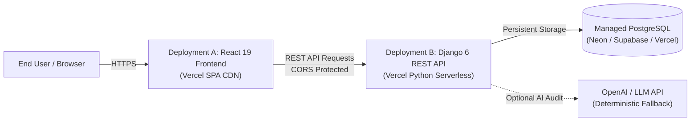

# Scalezix — Project 3: Client Onboarding Document Checker
## Production Deployment Guide (Vercel Two-Project Architecture)

This document provides complete instructions for deploying the **Scalezix Client Onboarding Document Checker** to production using Vercel for both the React frontend and Django REST API backend.

---

## 1. Architecture Overview

The application is deployed as **two independent, decoupled projects** on Vercel from the same Git repository:



| Deployment | Directory | Runtime | Artifact / Output | Vercel Project Name |
| :--- | :--- | :--- | :--- | :--- |
| **Frontend (A)** | `03-Client-Onboarding-Checker/frontend` | Node.js (Vite 8) | `dist` | `scalezix-onboarding-frontend` |
| **Backend (B)** | `03-Client-Onboarding-Checker/backend` | Python 3.13 | WSGI Serverless Function | `scalezix-onboarding-backend` |

---

## 2. Production Database Setup (PostgreSQL)

Serverless functions on Vercel run on an ephemeral, read-only filesystem (except `/tmp`). A persistent managed PostgreSQL database must be used in production.

### Recommended Providers (Free/Serverless Tier Compatible)
1. **Neon Serverless Postgres** ([neon.tech](https://neon.tech))
2. **Supabase Postgres** ([supabase.com](https://supabase.com))
3. **Vercel Postgres / Storage**

### Database Setup Procedure
1. Create a PostgreSQL project/database on Neon or Supabase.
2. Copy the pooled connection string (`DATABASE_URL`), which looks like:
   ```text
   postgresql://<username>:<password>@<host-pooler>.neon.tech/<dbname>?sslmode=require
   ```
3. Run migrations once from your local workstation or CI runner targeting the production database:
   ```bash
   cd 03-Client-Onboarding-Checker/backend
   
   # Set the production connection string temporarily
   $env:DATABASE_URL="postgresql://<username>:<password>@<host-pooler>.neon.tech/<dbname>?sslmode=require"
   
   # Apply database migrations
   python manage.py migrate
   
   # Seed standard onboarding checklist templates and fictional demo cases
   python manage.py seed_data
   ```

---

## 3. Backend Deployment (Deployment B: Django REST API)

### Step 3.1: Import Project in Vercel
1. Log in to [Vercel Dashboard](https://vercel.com/dashboard).
2. Click **Add New...** > **Project**.
3. Import the `client-onboarding-checker` repository.
4. Set **Project Name**: `scalezix-onboarding-backend`.
5. Under **Root Directory**, click **Edit** and select:
   ```text
   03-Client-Onboarding-Checker/backend
   ```
6. **Framework Preset**: Leave as *Other*.

### Step 3.2: Configure Backend Environment Variables
Add the following variables under **Environment Variables**:

| Variable Name | Production Value | Required? | Purpose |
| :--- | :--- | :--- | :--- |
| `DJANGO_SECRET_KEY` | *(Generate a 50+ character random string)* | **Yes** | Django cryptographic signing |
| `DJANGO_DEBUG` | `False` | **Yes** | Disables debug mode and tracebacks |
| `DJANGO_ALLOWED_HOSTS` | `.vercel.app,localhost,127.0.0.1` | **Yes** | Host header validation |
| `DATABASE_URL` | `postgresql://...sslmode=require` | **Yes** | Persistent PostgreSQL connection |
| `DB_CONN_MAX_AGE` | `0` | Recommended | Connection pooling (0 for serverless) |
| `CORS_ALLOWED_ORIGINS` | `https://scalezix-onboarding-frontend.vercel.app` | **Yes** | Allows requests only from your frontend |
| `CSRF_TRUSTED_ORIGINS` | `https://scalezix-onboarding-frontend.vercel.app,https://scalezix-onboarding-backend.vercel.app` | **Yes** | CSRF origin protection |
| `OPENAI_API_KEY` | `sk-...` *(optional)* | No | Enables AI-assisted reviews (fallback active) |
| `MAX_UPLOAD_SIZE_MB` | `10` | No | Enforces 10 MB maximum upload limit |

### Step 3.3: Deploy Backend
1. Click **Deploy**.
2. Once complete, copy the backend production URL:
   `https://scalezix-onboarding-backend.vercel.app`

---

## 4. Frontend Deployment (Deployment A: React SPA)

### Step 4.1: Import Project in Vercel
1. On Vercel Dashboard, click **Add New...** > **Project**.
2. Select the same `client-onboarding-checker` repository.
3. Set **Project Name**: `scalezix-onboarding-frontend`.
4. Under **Root Directory**, click **Edit** and select:
   ```text
   03-Client-Onboarding-Checker/frontend
   ```
5. **Framework Preset**: Select **Vite** (auto-detected).
6. **Build Command**: `npm run build`
7. **Output Directory**: `dist`
8. **Install Command**: `npm install`

### Step 4.2: Configure Frontend Environment Variables
Add the following variable under **Environment Variables**:

| Variable Name | Production Value | Description |
| :--- | :--- | :--- |
| `VITE_API_BASE_URL` | `https://scalezix-onboarding-backend.vercel.app` | The URL of your deployed Django backend |

### Step 4.3: Deploy Frontend
1. Click **Deploy**.
2. Once complete, copy the frontend production URL:
   `https://scalezix-onboarding-frontend.vercel.app`
3. If this URL differs from what you entered in the backend's `CORS_ALLOWED_ORIGINS`, update the backend environment variable and redeploy the backend.

---

## 5. Post-Deployment Verification & QA Checklist

Verify the deployed applications using the following checklist:

### A. Backend Verification
- [ ] **Health Check**:
  ```bash
  curl -i https://scalezix-onboarding-backend.vercel.app/api/health/
  ```
  Expected: `HTTP 200 OK`, JSON `{"status": "healthy", "service": "Scalezix Client Onboarding Document Checker"}`
- [ ] **Dashboard Stats**:
  ```bash
  curl -i https://scalezix-onboarding-backend.vercel.app/api/dashboard/stats/
  ```
  Expected: `HTTP 200 OK` with JSON statistics.
- [ ] **Templates Blueprint**:
  ```bash
  curl -i https://scalezix-onboarding-backend.vercel.app/api/templates/
  ```
  Expected: `HTTP 200 OK` with 3 standard blueprint templates.
- [ ] **Cases Listing**:
  ```bash
  curl -i https://scalezix-onboarding-backend.vercel.app/api/cases/
  ```
  Expected: `HTTP 200 OK` with seeded demo onboarding cases.
- [ ] **Security**: Verify `DEBUG=False` by requesting a non-existent URL:
  ```bash
  curl -i https://scalezix-onboarding-backend.vercel.app/api/does-not-exist/
  ```
  Expected: Standard 404 response without any Python stack trace or Django debug banner.

### B. Frontend Verification
- [ ] Open `https://scalezix-onboarding-frontend.vercel.app` in a browser.
- [ ] Verify the header and footer display **Backend Connected** in green.
- [ ] Click on **Cases** (`/cases`) and confirm cases render from the backend.
- [ ] Refresh the page while on `/cases` or `/cases/:id` to confirm SPA fallback routing works (no 404).
- [ ] Navigate to **Templates** (`/templates`) and verify standard blueprints.
- [ ] Open a case, run **Gap Analysis**, and verify findings appear instantly.
- [ ] Click **Generate Follow-Up** to verify client email composer drafts accurately.
- [ ] Test **Export CSV** and **Export Report (.md)** downloads.

---

## 6. Security Guarantees & DevSecOps Runbook

1. **Zero Raw Credential Storage**:
   - The platform scans all notes and filenames using conservative regex pattern matching for AWS, Stripe, GitHub, Slack, OpenAI, RSA/SSH private keys, and passwords.
   - Any detected credential triggers a High-severity `security_concern` finding and is replaced with `[REDACTED_...]` placeholders prior to CSV/Markdown export or AI transmission.
2. **Untrusted Data Handling**:
   - Client submissions are treated as untrusted data.
   - AI service prompts enforce strict system-level constraints and schema validation.
   - Deterministic fallback runs automatically if the AI provider is unavailable.
3. **CORS & CSRF Enforcement**:
   - Wildcard CORS origins are forbidden in production.
   - Only exact allowed frontend origins are permitted.
   - Cookies and sessions are marked `Secure`, `HttpOnly`, and `SameSite`.

---

## 7. Local Testing Commands

Before pushing any changes:

```bash
# Backend Test Suite (17 tests)
cd 03-Client-Onboarding-Checker/backend
python manage.py test

# Frontend Test Suite (6 tests)
cd 03-Client-Onboarding-Checker/frontend
npm test

# Frontend Type Check & Build
npm run type-check
npm run build
```

